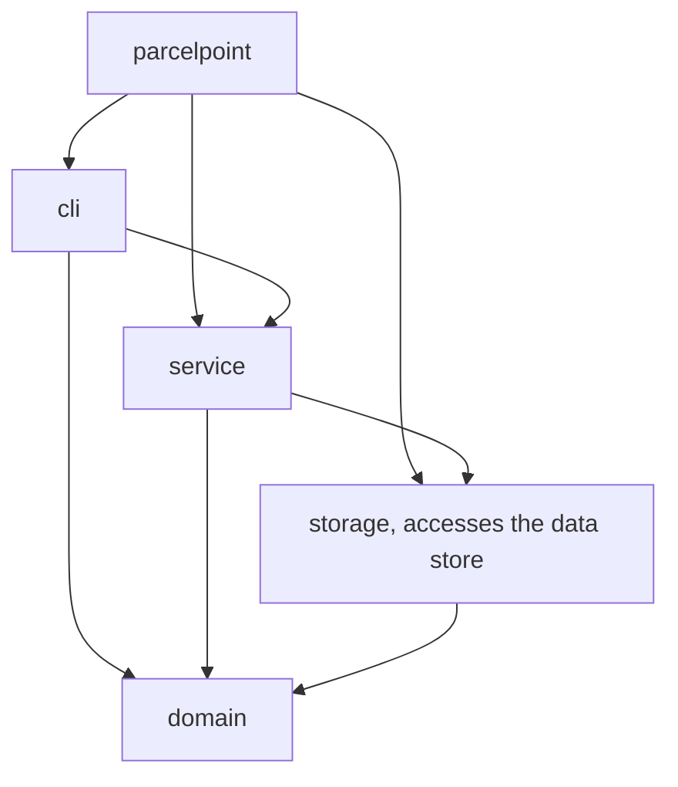
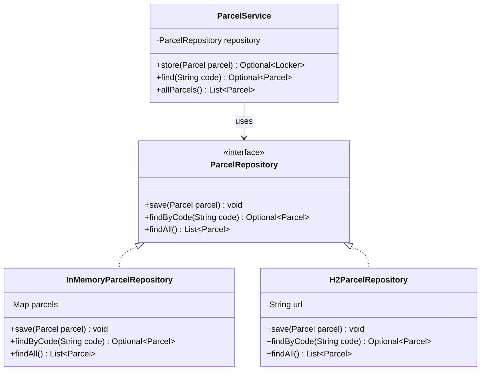
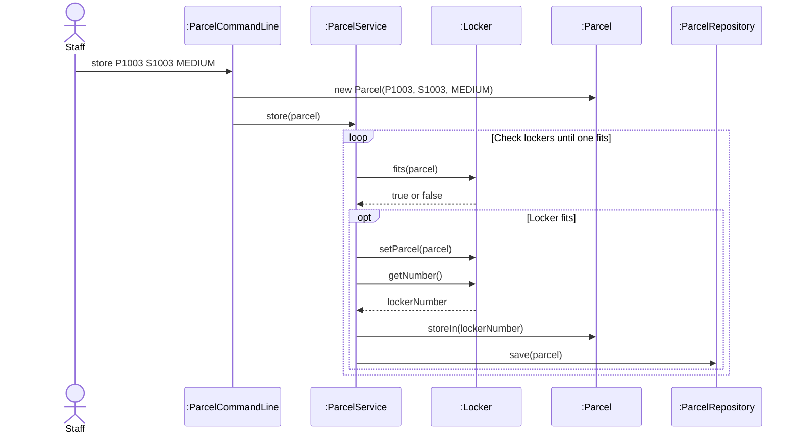

# Lab Report, Designing the Data Management Layer with H2

Repository URL:https://github.com/Bunnybbell/itcs382-h2-lab.git

## Tools

| Item | Version or name |
| --- | --- |
| JDK |	Eclipse Temurin OpenJDK 25.0.4.1 LTS |
| Maven |Apache Maven 3.10.0 |
| IDE |Visual Studio Code 1.143.0 |
| AI tool and exact model, if you used one |ChatGPT (GPT-6)  |

## Part 0. From a store in memory to H2

Commit of the starter, before any change:e902811

0.3 Your prediction for `staff`, written before the second run: I predict that staff will show no parcels and all three lockers will be free because the data was only stored in memory.

Output of the second run, for `staff` and `quit`:

```text
> staff
Free lockers: 3
> quit
```

State in one sentence where you think the parcels of the first run were kept.
The parcels were stored in a LinkedHashMap in the program's memory, so the data disappeared when the program ended
0.5 The line of Main that you would change to keep the parcels somewhere else:

```java
       ParcelRepository repository = new InMemoryParcelRepository();
```

0.6 Commit of the switch to H2: f573b40 (HEAD -> main) Switch to H2

0.7 Output of `SELECT * FROM PARCEL;` after you stored two parcels:

```text
 SELECT * FROM PARCEL;
CODE  | STUDENT_ID | PARCEL_SIZE | STATUS | LOCKER_NUMBER
P1001 | S1001      | SMALL       | STORED | 1
P1002 | S1002      | LARGE       | STORED | 3
(2 rows, 9 ms)
```

0.8 Explain why ParcelPoint could not start while the H2 Shell was open, and identify the class that wrote the message `Cannot create the PARCEL table`.
ParcelPoint could not start because the H2 database file was already locked by another process, possibly the H2 Shell. The error message "Cannot create the PARCEL table" was generated by H2ParcelRepository. After closing the other database connection, ParcelPoint can access the database again.
0.9 Explain why `staff` shows no parcel while `find` shows each one, and why all three lockers look free.
The staff command shows no parcels because findAll() in H2ParcelRepository is not implemented and always returns an empty list. However, findByCode() reads the parcels directly from the H2 database, so the find command works. All three lockers appear free because the ParcelService constructor uses findAll() to restore the stored parcels into their lockers when the program starts.
0.11 Your findAll method:

```java

@Override
public List<Parcel> findAll() {
    List<Parcel> parcels = new ArrayList<>();
    String sql = "SELECT * FROM PARCEL ORDER BY CODE";

    try (Connection connection = connect();
         PreparedStatement statement = connection.prepareStatement(sql);
         ResultSet row = statement.executeQuery()) {

        while (row.next()) {
            parcels.add(toParcel(row));
        }

    } catch (SQLException e) {
        throw new IllegalStateException("Cannot read the parcels", e);
    }

    return parcels;
}

```

Commit that adds findAll: 3eaa82d (HEAD -> main) Write findAll

0.12 Output of `SELECT * FROM PARCEL;` after the pickup:

```text
CODE  | STUDENT_ID | PARCEL_SIZE | STATUS    | LOCKER_NUMBER
P1001 | S1001      | SMALL       | PICKED_UP | null
P1002 | S1002      | LARGE       | STORED    | 3
(2 rows, 9 ms)
```

0.13 Optional. Describe what `find P9999'OR'1'='1` showed while the SQL was joined from strings, and what it showed after you put the placeholder back.

Without the placeholder, the SQL injection input returned a parcel even though the requested code did not exist.

After restoring the PreparedStatement with the `?` placeholder and `statement.setString(1, code)`, the same input returned "No parcel with code P9999'OR'1'='1".

This shows that using a PreparedStatement with parameters prevents SQL injection.

## Part A. Model the design

A1 Complete the flowchart with one node for each package and one arrow for each dependency, from the package that uses to the package that is used. Mark the package that accesses the data store.



State whether cli depends on storage, and explain why.
No, cli does not depend directly on storage. The cli package communicates with ParcelService in the service package, while ParcelService accesses the ParcelRepository interface in storage. This keeps the command-line interface independent of the data store implementation.
A2 Complete the class diagram of the data management layer with ParcelService, the interface ParcelRepository with its three operations, and the two classes that implement it.



A3 Draw a sequence diagram for the command `store P1003 S1003 MEDIUM`, from the staff member to the repository. Show each message as an operation of the class that receives it.



Explain why the last lifeline is the interface ParcelRepository rather than H2ParcelRepository.
The last lifeline is ParcelRepository because ParcelService depends on the repository interface rather than a specific implementation. This follows the Dependency Inversion Principle and allows the data store to change without modifying ParcelService.
## Part B. Design questions

1. Identify the files that you changed to move from the store in memory to H2, and explain why no other class had to change. Use the terms of this course.
I changed Main.java to use H2ParcelRepository instead of InMemoryParcelRepository. I also implemented the findAll() method in H2ParcelRepository.java to read all parcels from the database. No other classes needed changes because ParcelService depends on the ParcelRepository interface, following the Dependency Inversion Principle.
2. The PARCEL table stores the size of a parcel as SMALL, MEDIUM or LARGE rather than as 1, 2 or 3. Identify the type of connascence between ParcelSize and the table in each case, and explain which one is weaker.
Storing SMALL, MEDIUM and LARGE uses Connascence of Name because the database values must match the names of the ParcelSize enum. Storing 1, 2 and 3 would use Connascence of Convention because both sides must agree on what each number means. Connascence of Name is weaker because the values are easier to understand and maintain.
3. Project Phase 2 asks for a data store that needs no separate server. Explain why an embedded database such as H2 meets this rule, and describe the limit of an embedded database that Step 0.8 showed.
H2 is an embedded database that runs inside the Java application, so it does not need a separate database server. It can store data in a file and keep the data after the program closes. However, as shown in Step 0.8, another process cannot open the same embedded database file while it is already locked.
4. State the data store that you would choose for your Project Phase 2 team, files or an embedded database, the requirement that drives the choice, and the package that will access it.
I would choose an embedded H2 database for our Project Phase 2. Our system needs to store structured data persistently without requiring a separate server. The storage package will manage database access through repository interfaces, keeping the business logic independent of the data store.
## AI usage declaration

| AI tool and exact model | Date | Purpose | Files or answers it produced or changed | How you checked its output |
| --- | --- | --- | --- | --- |
|	ChatGPT (GPT-6) |11 November 2026 |Explain lab steps, assist with Java code, Mermaid diagrams and design questions |Suggested changes to Main.java, H2ParcelRepository.java and answers for LAB_REPORT.md |I checked the AI-generated output by building and running the program, checking the SQL results in H2 Shell, and verifying the diagrams using Mermaid Live.|
